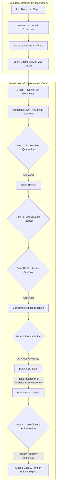
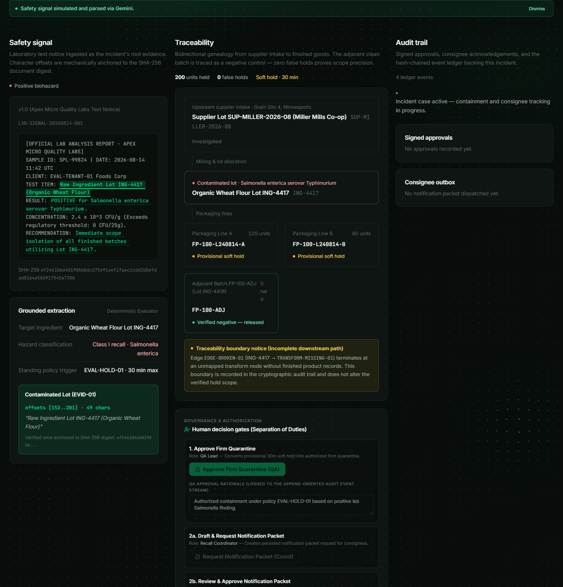
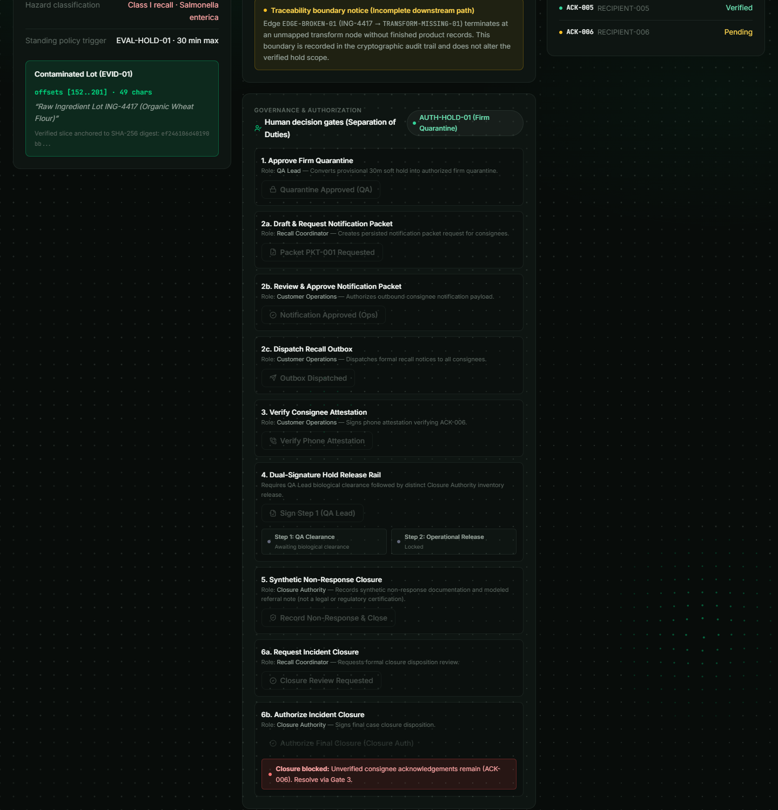
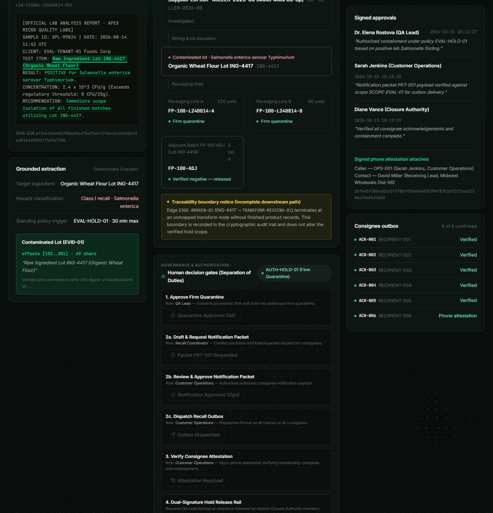

# Lot Zero — Evidence-Grounded Food Safety Recall Incident Workspace

> **Disciplined, Deterministic Supply Chain Recall Incident Workspace**
> *Combining Grounded AI Extraction, Deterministic Supply Chain Genealogy Traversal, a Strict Separation-of-Duties Authority Kernel, FastAPI, and React.*

[](apps/api/tests/)
[](apps/web/tests/)
[](https://python.org)
[](https://react.dev)
[](https://fastapi.tiangolo.com)

**Live Demo**: [https://lot-zero-m4vizenaoa-uc.a.run.app](https://lot-zero-m4vizenaoa-uc.a.run.app)
<br>**Repository**: [https://github.com/ryuzaki1709/lot-zero](https://github.com/ryuzaki1709/lot-zero)
<br>**Case Study**: [Engineering Case Study](docs/portfolio_case_study.md)
<br>**LinkedIn Launch**: [LinkedIn Announcement Draft](docs/linkedin_launch.md)

---

## 1. What Lot Zero Does

When pathogenic contamination (such as *Salmonella enterica*) is detected in a food manufacturing supply chain, recall coordinators and quality assurance leads face two compounding risks:
1. **Over-Containment (False Holds)**: Indiscriminately shutting down entire facilities or adjacent clean packaging lines destroys unaffected inventory and creates catastrophic supply chain disruptions.
2. **Under-Containment & Missing Consignee Reconciliation**: Missing contaminated downstream batches or failing to verify consignee receipt violates recall effectiveness regulations and endangers public health.
3. **Unbounded LLM Risks**: Unconstrained generative chatbots risk hallucinating lot IDs, miscalculating quantities, or executing unvetted operational commands without governance.

**Lot Zero** resolves this with **Disciplined Agency**:
- **Grounded Evidence Extraction**: Ingests unstructured lab reports using Google Gemini, extracting positive pathogen findings with verbatim character-offset citation spans dynamically validated against the lab document's SHA-256 digest. Live-model failures return `needs_review` rather than silently making automated decisions.
- **Deterministic Genealogy Traversal**: Graph traversal calculates exact downstream finished batches (`FP-100-L240814-A`: 120 units, `FP-100-L240814-B`: 80 units, totaling 200 units) while provably leaving adjacent clean control batches (`FP-100-ADJ`: 100 units) unheld (zero false holds strictly verified on the synthetic evaluation fixture).
- **Enforced Separation of Duties**: Multi-persona governance blocks self-approvals (`requester != approver`), requiring distinct operational roles for quarantine, notice dispatch, and final case closure.
- **Reconciliation-Gated Closure**: Case closure is strictly blocked until all consignee receipts are verified (via phone attestation or modeled non-response documentation) and authorized by an independent Closure Authority.
- **Separate Hold-Release Rail**: In addition to case closure, physical hold release operates on an independent two-step rail requiring QA Lead biological clearance (with re-test hash) followed by Closure Authority release.
- **Tamper-Evident Audit Export**: Every state mutation appends to an append-oriented SQLite event stream, and an exportable, self-verifying SHA-256 hash-chained JSON audit bundle is dynamically constructed upon export.

---

## 2. Core Architecture Principle: Disciplined Agency

In mission-critical regulated operations, generative AI should never make autonomous operational decisions. Lot Zero enforces a strict boundary: **Grounded Model Extraction feeds a Deterministic Domain Kernel**.



- **Where Lot Zero Automates**:
  - Ingests unstructured laboratory reports and maps character spans to verified document digests.
  - Traverses raw material lot genealogy graphs to calculate downstream batch impacts.
  - Automatically initiates a 30-minute provisional soft hold (`EVAL-HOLD-01`) upon signal confirmation to protect safety during discovery.
- **Where Lot Zero Strictly Halts**:
  - Upgrading a soft hold to permanent firm quarantine requires **QA Lead** sign-off.
  - Dispatching outbound consignee recall notices requires distinct **Recall Coordinator** and **Customer Operations** approvals.
  - Case closure is blocked while consignee acknowledgements remain unverified.
  - Final case closure requires independent **Closure Authority** sign-off (`requester != approver`). Releasing physical holds requires a separate two-step biological/operational release rail.

---

## 3. Visual Walkthrough & Verified Capabilities

The screenshots below are captured from local deterministic replay evaluation runs:

### A. Grounded Evidence Extraction & Supply Chain Genealogy
Ingests unstructured lab contamination reports, highlights verbatim character spans verified against the report SHA-256 digest, and traverses the lot graph to isolate contaminated lots while keeping adjacent clean lots unheld (zero false holds on the synthetic fixture).



### B. Separation-of-Duties Approvals & Blocked Closure Gates
Multi-role action center enforces distinct personas (`requester != approver`). Case closure is blocked until unverified consignees are reconciled via phone attestation or modeled non-response documentation.



### C. Reconciled Approvals & Verified Audit Export
Recorded signed approvals, verified phone attestation with SHA-256 hash, and fully reconciled consignee outbox (6 of 6 confirmed) from local deterministic replay. The self-verifying SHA-256 audit bundle is verified and downloadable separately ([docs/audit_export_verification.json](docs/audit_export_verification.json)).



---

## 4. Technology Stack

| Layer | Technologies & Versions | Purpose & Implementation Details |
| :--- | :--- | :--- |
| **Backend Runtime** | Python `>=3.12,<3.13`, FastAPI `0.115.14`, Pydantic `2.13.4` | Asynchronous REST API, typed schema enforcement, event dispatch. |
| **Domain Kernel** | Pure Python Domain Model | Finite state machine, separation-of-duties authority engine, graph traversal. |
| **Persistence** | SQLite (Append-Oriented Ledger) | Event store recording `incident_events`; export generator computes SHA-256 hash chains upon export. |
| **Frontend UI** | React `19.2.0`, Vite `6.4.2` | Single-page incident workspace with resilient in-memory storage fallback. |
| **Design System** | Custom CSS System (`antigravity.css`, `responsive.css`) | Semantic CSS custom properties, responsive breakpoints (no Tailwind dependency). |
| **Real-Time Sync** | Server-Sent Events (SSE) | 60-second HMAC-SHA256 authenticated tokens via `POST /api/sse-token`. |
| **AI Ingestion** | Google Gemini `gemini-3.5-flash` via `google-genai` SDK | Grounded extraction; live model failures yield `needs_review`; replay mode available. |
| **Testing** | Pytest (`170` passed), Node Test (`30` passed) | Deterministic replay suites, contract verification, and offline tests. |

---

## 5. Separation-of-Duties Persona Model

In evaluation mode (`LOT_ZERO_EVALUATION_MODE=true`), five evaluation personas demonstrate governance controls:

| Persona Name | Principal ID | Role | Evaluation API Key | Key Responsibilities |
| :--- | :--- | :--- | :--- | :--- |
| **Evaluation Administrator** | `EVAL-ADMIN-01` | `eval_admin` | `key-eval-admin-01` | Reset baseline state and archive prior runs. |
| **Recall Coordinator** | `RECALL-COORD-01` | `recall_coordinator` | `key-recall-coord-01` | Ingest signal, propose scope, request notice, request closure. |
| **QA Lead** | `QA-LEAD-01` | `qa` | `key-qa-lead-01` | Approve firm quarantine (`AUTH-HOLD-01`), biological clearance for hold release. |
| **Customer Operations** | `OPS-001` | `customer_operations` | `key-ops-01` | Approve notice packet, dispatch outbox, verify phone attestations. |
| **Closure Authority** | `CLOSURE-AUTH-01` | `closure_authority` | `key-closure-auth-01` | Step 2 operational release, authorize final case closure. |

> [!IMPORTANT]
> **Anti-Self-Approval Enforcement**: If an operator attempts to approve their own request (e.g. `RECALL-COORD-01` attempting to approve firm quarantine or sign closure), the domain kernel rejects the command with **HTTP 403 Forbidden** (`requester and approver must be different people`).

---

## 6. Audit Trail & Cryptographic Guarantees

The SQLite database persists the append-oriented event stream (`incident_events`). During audit export generation, the export engine computes an incremental SHA-256 hash chain over the ordered event stream:

$$\text{entry\_hash}_n = \text{SHA256}(\text{sequence} \parallel \text{event\_type} \parallel \text{payload\_hash} \parallel \text{prior\_entry\_hash}_{n-1} \parallel \text{occurred\_at})$$

### Audit Bundle Export
Download the complete self-verifying audit bundle directly via the web UI (**Export Audit Bundle**) or via API:
```bash
curl -s http://localhost:8000/api/cases/EVAL-CASE-01/audit-export \
     -H "X-API-Key: key-recall-coord-01"
```

### Clarification of Cryptographic Boundaries
- **Authenticated Actor Attribution**: State transitions record the authenticated role and principal ID (`actor_id`, `actor_role`) of the caller. This provides tamper-evident principal attribution in the audit trail, not asymmetric/PKI digital signatures.
- **HMAC Session Tokens**: Ephemeral tokens for Server-Sent Events are signed with HMAC-SHA256 (`POST /api/sse-token`).
- **Append-Oriented Ledger**: Events are stored in an append-oriented SQLite table (`incident_events`). Tamper-evidence detects modification, deletion, or reordering when evaluated against an independently retained root hash; it does not replace dedicated hardware WORM storage.

---

## 7. Local Setup & Quickstart

### Prerequisites
- **Python**: `>=3.12,<3.13` (matching `pyproject.toml`)
- **Node.js**: `20` (matching CI and build) and `npm`

### Windows (PowerShell)
```powershell
# 1. Clone repository
git clone https://github.com/ryuzaki1709/lot-zero.git
cd lot-zero

# 2. Set up Python environment
python -m venv .venv
.\.venv\Scripts\Activate.ps1
python -m pip install --upgrade pip
python -m pip install -c constraints.txt -c constraints-dev.txt -e "apps/api[dev]"

# 3. Set up and build frontend
cd apps\web
npm ci
npm run build
cd ..\..

# 4. Launch backend in evaluation mode (deterministic replay)
$env:LOT_ZERO_EVALUATION_MODE = "true"
$env:GOOGLE_GENAI_USE_VERTEXAI = "false"
Remove-Item Env:\GEMINI_API_KEY -ErrorAction SilentlyContinue
.\.venv\Scripts\python.exe -m uvicorn lot_zero.app:app --host 127.0.0.1 --port 8000 --app-dir apps/api/src
```

### Linux / macOS (Bash)
```bash
# 1. Clone repository
git clone https://github.com/ryuzaki1709/lot-zero.git
cd lot-zero

# 2. Set up Python environment
python3 -m venv .venv
source .venv/bin/activate
python3 -m pip install --upgrade pip
python3 -m pip install -c constraints.txt -c constraints-dev.txt -e "apps/api[dev]"

# 3. Set up and build frontend
cd apps/web
npm ci
npm run build
cd ../..

# 4. Launch backend in evaluation mode (deterministic replay)
export LOT_ZERO_EVALUATION_MODE=true
export GOOGLE_GENAI_USE_VERTEXAI=false
unset GEMINI_API_KEY
uvicorn lot_zero.app:app --host 127.0.0.1 --port 8000 --app-dir apps/api/src
```

Open [**http://localhost:8000**](http://localhost:8000) in your browser.

---

## 8. Guided Evaluation Walkthrough

To verify the end-to-end incident lifecycle:

1. **Reset State** (`Evaluation Administrator`):
   - Switch persona to **Evaluation Administrator** in the top bar.
   - Click **Reset State** &rarr; Confirm. The incident reinitializes to `signal_received`.
2. **Ingest Safety Signal** (`Recall Coordinator`):
   - Switch persona to **Recall Coordinator**.
   - Click **Simulate Signal**. The grounded extraction engine extracts contaminated lot `ING-4417`, traverses the genealogy graph, places a 30m soft hold on batches `FP-100-L240814-A` and `FP-100-L240814-B` (200 units total), and advances the case to `provisional_containment`.
3. **Approve Firm Quarantine** (`QA Lead`):
   - Switch persona to **QA Lead**.
   - Click **Approve Firm Quarantine (QA)** with a rationale. Advances the case to `action_review`.
4. **Draft & Approve Outbound Notice**:
   - Switch to **Recall Coordinator**: Click **Request Notification Packet (Coord)**.
   - Switch to **Customer Operations**: Click **Approve Notification Packet (Ops)**.
5. **Dispatch Outbox & Observe Blocked Gate** (`Customer Operations`):
   - Click **Dispatch Recall Outbox (Ops)**. The incident enters `ack_monitoring`.
   - Switch to **Recall Coordinator** and click **Request Case Closure (Coord)**.
   - Notice the closure gate is **BLOCKED**: Consignee `ACK-006` is unverified.
6. **Reconcile Outstanding Consignee** (`Customer Operations`):
   - Switch to **Customer Operations**. Under Consignee Outreach for `ACK-006`, click **Verify Phone Attestation** &rarr; Submit. The case advances to `effectiveness_check`.
7. **Authorize Final Case Closure** (`Closure Authority`):
   - Switch persona to **Closure Authority**.
   - Click **Authorize Final Closure (Closure Auth)**. The case transitions to `closed`.
8. **Export Audit Bundle**:
   - Click **Export Audit Bundle** in the top bar to inspect the SHA-256 hash-chained JSON ledger.

---

## 9. Automated Testing & Code Quality

```powershell
# Backend verification (170 passed tests)
.\.venv\Scripts\python.exe -m pytest .\apps\api\tests -q --tb=short -p no:cacheprovider

# Static analysis and linting (0 errors)
.\.venv\Scripts\python.exe -m ruff check .\apps\api
.\.venv\Scripts\python.exe -m ruff format --check .\apps\api
.\.venv\Scripts\python.exe -m mypy .\apps\api\src

# Frontend verification (30 passed tests)
cd apps\web
npm test
npm run build
cd ..\..

# Markdown link integrity audit
.\.venv\Scripts\python.exe .\scripts\audit_markdown_links.py
```

---

## 10. Prototype Limitations & Tradeoffs

1. **Single-Instance Concurrency**: The current runtime coordinates state transitions using an in-memory asynchronous lock (`state_lock`) backed by SQLite. Multi-worker or distributed deployments require distributed leasing (e.g. Redis/PostgreSQL).
2. **Synthetic Data Fixture**: The demonstration environment operates on a synthetic scenario (Apex Micro Quality Labs report, *Salmonella enterica*, ingredient `ING-4417`, and downstream batches `FP-100-L240814-A/B`). Zero false holds is an empirical result verified on this synthetic test fixture.
3. **Synthetic Internal Workflow**: The workflow implements a synthetic demonstration of recall reconciliation (including phone attestation and modeled non-response handling) for illustrative incident management. It operates on synthetic fixtures and is not a legal, regulatory, or compliance certification.
4. **Actor Attribution vs. PKI Signatures**: Governance decisions are recorded as authenticated role-based principal attributions in the event ledger, not asymmetric public-key digital signatures.

---

## 11. Project Documentation Index

- **Case Study**: [docs/portfolio_case_study.md](docs/portfolio_case_study.md) — Comprehensive technical architecture and design case study.
- **LinkedIn Announcement**: [docs/linkedin_launch.md](docs/linkedin_launch.md) — Launch post drafts and framing.
- **Technical Architecture**: [docs/architecture.md](docs/architecture.md) — Detailed kernel design and data flow.
- **Security & Trust Specification**: [docs/security.md](docs/security.md) — Threat model, RBAC, and hash-chaining details.
- **Deployment Guide**: [docs/deployment.md](docs/deployment.md) — Cloud Run deployment specifications.
- **Deployment Verification**: [docs/deployment_evidence.md](docs/deployment_evidence.md) — Verification of Cloud Run deployment.
- **Historical Records**: [docs/submission.md](docs/submission.md), [docs/late_submission_rescue.md](docs/late_submission_rescue.md) — Historical development and hackathon context.
