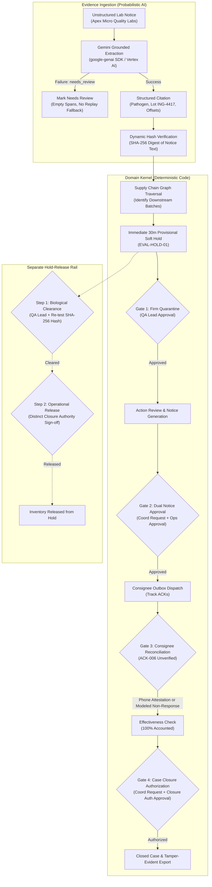

# Engineering Case Study: Lot Zero

## Building a High-Integrity Food Safety Recall Workspace with Disciplined Agency

---

## 1. Executive Summary & Problem Context

In food manufacturing and processing, a pathogen contamination detection (e.g. *Salmonella*, *Listeria*, *E. coli*) triggers an urgent crisis. Recall teams must balance two conflicting mandates under extreme time pressure:
- **Public Safety Mandates**: Ensuring zero contaminated product reaches consumers or remains unaccounted for in distribution networks.
- **Business Continuity & Food Waste Prevention**: Avoiding indiscriminate, over-broad facility shutdowns that destroy millions of dollars in uncontaminated product ("false holds").

Traditionally, response teams coordinate recalls using ad-hoc spreadsheets, disparate emails, and hurried phone calls. When modern software teams attempt to apply generative AI to this problem, they often introduce dangerous failure modes: conversational agents that hallucinate lot codes, invent stock quantities, or execute operational holds without verified evidence or governance.

**Lot Zero** was engineered as an alternative: a **disciplined recall incident workspace** that pairs grounded generative AI extraction with a strictly deterministic, separation-of-duties domain kernel.

---

## 2. Intended Users & Operational Personas

Lot Zero is designed for four primary operational roles within food manufacturing, quality assurance, and distribution operations:

1. **Recall Coordinator (`recall_coordinator`)**: Coordinates incident discovery, reviews incoming laboratory signals, proposes containment scope, drafts consignee notification packets, and submits the incident for closure once requirements are met.
2. **Quality Assurance Lead (`qa`)**: Evaluates pathogen findings, authorizes firm quarantine policies, and conducts biological safety evaluations required for clearance.
3. **Customer Operations Lead (`customer_operations`)**: Reviews and approves outbound consignee notice packets, dispatches recall communications, and reconciles consignee acknowledgements (including phone attestations and non-response referrals).
4. **Closure Authority (`closure_authority`)**: Independent executive authority responsible for final operational release and authorizing permanent case closure.

In addition, an **Evaluation Administrator (`eval_admin`)** persona exists in evaluation mode to reset state and archive prior runs for auditing.

---

## 3. Core Architectural Principle: Disciplined Agency

The foundational design principle of Lot Zero is **Disciplined Agency**: *Probabilistic AI should ingest and parse unstructured evidence, but deterministic software must govern all supply chain computations, state transitions, and authority gates.*



### Grounded Extraction vs. Operational Execution
- **LLM Boundary**: The model (Google Gemini `gemini-3.5-flash`) is restricted to information extraction. It reads unstructured laboratory reports and returns structured JSON containing pathogen identification, affected raw lot identifiers, and exact character-offset spans `[start, end]`.
- **Integrity Verification**: The application dynamically computes the SHA-256 hash of the input document and validates that extracted offsets match the source text verbatim.
- **Explicit Failure Handling**: If live-model extraction encounters an API error or network exception, it returns `status="needs_review"` with empty spans. The system does not silently substitute a deterministic replay or fabricate citations; ungrounded or failed extractions halt for human review.
- **Deterministic Kernel**: The model never decides which batches to hold, never alters incident phases, and never approves gates. All downstream actions are executed by pure Python state machine logic.

---

## 4. Supply Chain Genealogy & Clean Batch Isolation

When a raw material lot is identified as contaminated, the domain kernel performs graph traversal across manufacturing batch records:

$$\text{Downstream Batches} = \{ B \mid \exists I \in \text{Ingredients}(B) \text{ where } I.\text{lot\_id} = \text{ContaminatedLot} \}$$

### Synthetic Scenario Data
In the benchmark evaluation scenario (Apex Micro Quality Labs report):
- **Contaminated Raw Material**: `ING-4417` (Organic Wheat Flour) tested positive for *Salmonella enterica*.
- **Contaminated Finished Good Batches**:
  - `FP-100-L240814-A`: Consumed `ING-4417` $\to$ **120.0 units quarantined**.
  - `FP-100-L240814-B`: Consumed `ING-4417` $\to$ **80.0 units quarantined**.
  - **Total Contaminated Product**: **200.0 units**.
- **Adjacent Clean Control Batch**:
  - `FP-100-ADJ`: Consumed clean control lot `ING-4418` on an adjacent packaging line $\to$ **100.0 units clean**.

### Zero False Holds on Synthetic Benchmark
Conventional blunt shutdowns often quarantine entire production shifts, shutting down lines that processed clean ingredients. By isolating only nodes connected in the directed ingredient graph, Lot Zero leaves `FP-100-ADJ` unheld, achieving **zero false holds** strictly within the supplied synthetic evaluation fixture. This demonstrates topological precision on this benchmark rather than an unverified universal claim across arbitrary manufacturing plants.

---

## 5. Separation-of-Duties Authority Kernel

A critical failure point in incident response software is privilege escalation and self-approval. Lot Zero enforces strict multi-role governance:

### 1. The Anti-Self-Approval Invariant
The domain kernel enforces that the principal requesting an action cannot be the principal approving it:
```python
if request.requested_by == approver_principal_id:
    raise AuthorityError("Requester and approver must be different people")
```
If `RECALL-COORD-01` attempts to approve their own quarantine policy or authorize closure, the API immediately responds with **HTTP 403 Forbidden**.

### 2. Reconciliation-Gated Case Closure
In rigorous recall operations, incident cases cannot be closed while consignees remain unaccounted for:
- Outbound recall notices are dispatched to consignees (`ACK-001` through `ACK-006`).
- Consignee `ACK-006` (e.g. Pacific Northwest Distribution) remains in an `unverified` state.
- If the Recall Coordinator attempts to close the incident, the closure gate transitions to **BLOCKED**:
  > *"Awaiting verified consignment acknowledgement from: ACK-006"*
- To unblock the case, Customer Operations must either:
  1. Record an authenticated **Phone Attestation** confirming quarantine of on-hand inventory.
  2. Document a synthetic internal **Non-Response Referral Note** (demonstrating structured exception handling; not an official legal or regulatory filing).

### 3. Case Closure vs. Separate Hold-Release Rail
A crucial architectural distinction exists between incident case closure and inventory hold release:
- **Case Closure Rail**: Once consignee reconciliation is verified, the Recall Coordinator requests closure (`RequestClosureCommand`), and an independent Closure Authority authorizes it (`ApproveClosureCommand`). Biological clearance is not a prerequisite for ordinary case closure.
- **Hold-Release Rail**: In contrast, releasing physical inventory from hold (`ApproveReleaseCommand`) operates on a separate two-step rail: Step 1 requires **QA Lead** biological clearance (citing an exact re-test document ID and 64-character SHA-256 hash); Step 2 requires an independent **Closure Authority** operational release.

---

## 6. Audit Integrity & Cryptographic Boundaries

### Append-Oriented Event Stream & Export Hash Chaining
The SQLite database stores the raw, append-only event stream (`incident_events`) recording `tenant_id`, `case_id`, `stream_version`, `event_type`, `payload`, and `occurred_at`.

During export bundle generation, the export engine constructs an incremental SHA-256 hash chain and computes a top-level digest:

$$\text{entry\_hash}_n = \text{SHA256}(\text{sequence} \parallel \text{event\_type} \parallel \text{payload\_hash} \parallel \text{prior\_entry\_hash}_{n-1} \parallel \text{occurred\_at})$$

The complete chain is exportable at any time as a verifiable JSON audit bundle containing:
- `case_id`, `tenant_id`, and `event_count`
- `top_level_digest`: Cumulative top-level hash representing total event history
- `events`: Array of chained event entries with payload digests and entry hashes

### Clear Disclosures of Audit Boundaries
- **Authenticated Actor Attribution vs. PKI Signatures**: Governance decisions record the authenticated role and principal ID (`actor_id`, `actor_role`) from the validated session. This provides tamper-evident role-based principal attribution in the audit ledger, not asymmetric/PKI digital signatures.
- **HMAC Session Tokens**: Ephemeral Server-Sent Events (SSE) streaming connections are authenticated via 60-second HMAC-SHA256 tokens (`POST /api/sse-token`).
- **Software Append Ledger vs. Hardware WORM**: Events are stored in an append-oriented SQLite table (`incident_events`). While the SHA-256 hash chain guarantees tamper-detection if any historic record is modified, deleted, or reordered against a retained top-level hash, it operates on a standard filesystem rather than dedicated physical WORM storage.

---

## 7. Frontend Engineering & Initialization Resilience

The frontend is a single-page application built with **React 19.2** and **Vite 6.4**, styled with a custom CSS design system using CSS custom properties (`antigravity.css` and `responsive.css`) without heavyweight utility frameworks.

### Initialization Resilience Fix
During deployment testing, fresh browser visits in restricted contexts (e.g. sandboxed iframes, partitioned storage, or browsers with storage access blocked) encountered:
> *"Offline / Sign-in / API Key Required"*

**Reproduced Failure Mechanism**:
`App.jsx` originally contained direct, unguarded `localStorage.getItem()` and `localStorage.setItem()` calls. In restricted browser environments, accessing `window.localStorage` throws a `SecurityError` or `DOMException`. In this reproduced condition, even when `/api/config` returned successfully, the subsequent attempt to access storage rejected the execution flow, diverting execution into the error catch block and triggering fail-closed offline authentication. (This mechanism reliably reproduces the symptom in restricted browser sandboxes, though historical live incidents may also reflect host networking or configuration factors).

**Architectural Remediation**:
1. **Safe Storage Wrapper (`authConfig.js`)**: Implemented `getSafeStorage()` with fallback probes. If `localStorage` access throws or is blocked, the client falls back to keeping credentials in **React in-memory state**.
2. **Explicit Connection State Machine**: Introduced explicit `configStatus` states (`loading`, `ready`, `failed`).
3. **Fail-Closed Security with Retry Action**: If server configuration genuinely fails (network unreachable or server offline), the application preserves fail-closed security by disabling action controls, but displays an actionable error alert with an explicit **Retry Connection** button.
4. **Automated Verification**: Added unit tests (`auth-config.test.mjs`) that test throwing storage mocks, and pattern checks that verify no raw, unhandled `localStorage` calls exist in `App.jsx`.

---

## 8. Deployment Architecture & Operational Tradeoffs

Lot Zero is packaged as a multi-stage Docker container deployed to **Google Cloud Run**:
- Multi-stage build compiles the Vite frontend into static assets served directly by the FastAPI backend under `/assets` and `/`.
- Health and configuration endpoints (`/api/health`, `/api/config`) provide container orchestration readiness.

### Key Engineering Tradeoffs
1. **Concurrency Model**: The application utilizes an asynchronous in-memory state lock (`state_lock`) with an SQLite-backed append ledger. This serializes state transitions within a single server instance, preventing race conditions under tested single-instance concurrency (`concurrency=10`). Horizontally scaled multi-container deployments will require distributed leasing (e.g. Redis or PostgreSQL).
2. **Deterministic Replay vs. Live Model Ingestion**:
   - For public demonstrations, continuous integration, and offline evaluation, the application defaults to deterministic replay mode when Vertex AI and API keys are disabled.
   - Replay mode prevents external model API inference charges during automated runs, though standard Cloud Run container hosting compute still incurs hosting costs.
   - Evaluation API keys are openly selectable demo credentials provided in evaluation mode; public deployments should keep live model access disabled to prevent unbounded third-party model inference charges.

---

## 9. AI-Assisted Development & The Creator's Role

This system was developed using AI-assisted engineering workflows. As the project creator:

> "I directed the project, evaluated AI-generated changes, and iterated on the architecture, implementation, and verification with coding assistants."

- **Role of Coding Assistants**: Coding assistants were utilized for generating initial endpoint skeletons, authoring boilerplate Pydantic models, parameterizing synthetic test fixtures, and scaffolding component templates.
- **Creator Oversight & Direction**: Directed the core Disciplined Agency paradigm, specified the separation-of-duties invariant (`requester != approver`), defined the graph traversal rules isolating contaminated batches from clean controls, and established strict deterministic verification standards without fabricated claims or unsupported assertions.

---

## 10. Known Limitations & Roadmap

1. **Enterprise Identity Integration**: The current implementation authenticates principals via configured API keys (`LOT_ZERO_API_KEYS`) and role headers. Production deployment requires integration with enterprise OIDC / SAML providers (e.g. Okta, Azure AD).
2. **Distributed Storage Backend**: Migrating from local SQLite to PostgreSQL with row-level security and distributed lock management.
3. **Multi-Tier Supplier Graph Ingestion**: Extending genealogy traversal beyond immediate tier-1 batch relationships to support complex multi-ingredient blending and recursive sub-component tracing.
